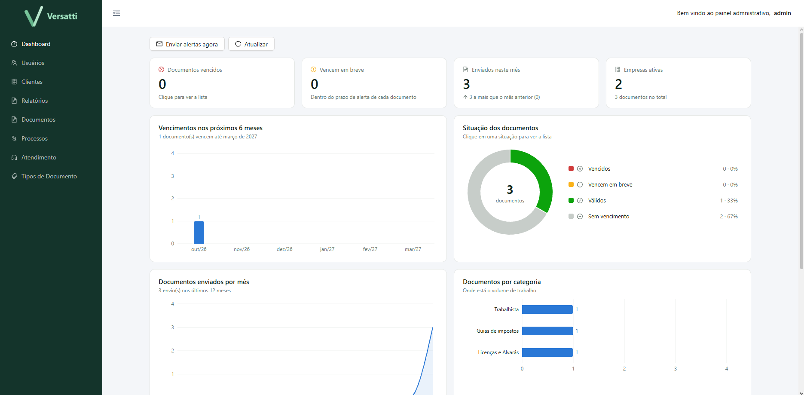
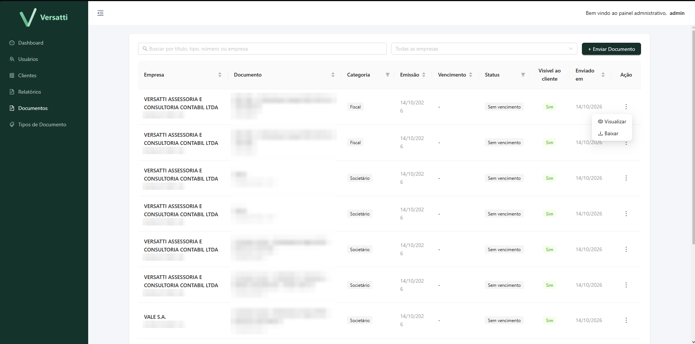
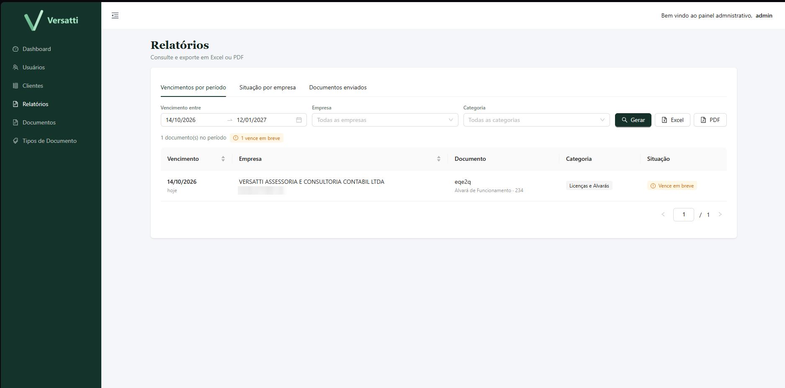
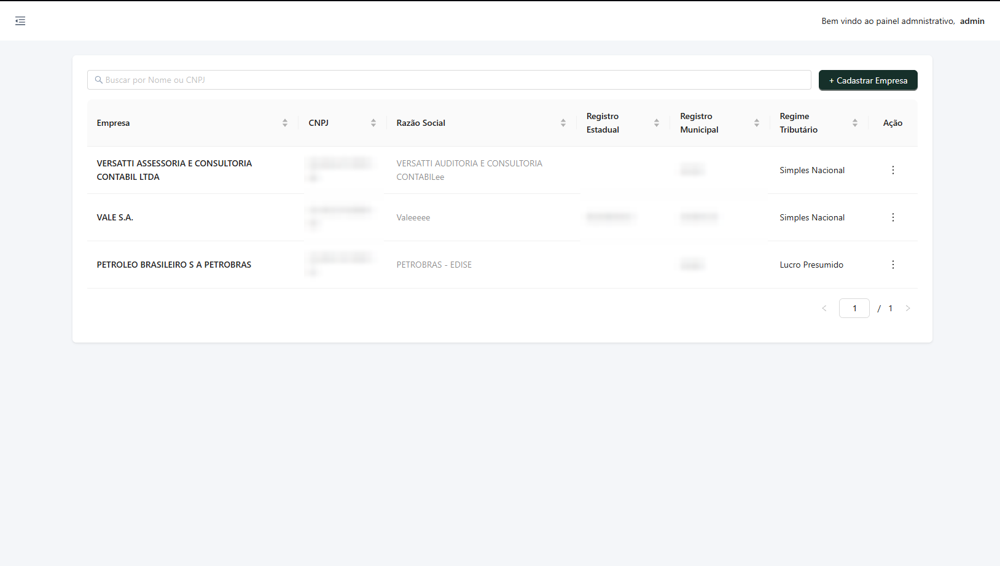
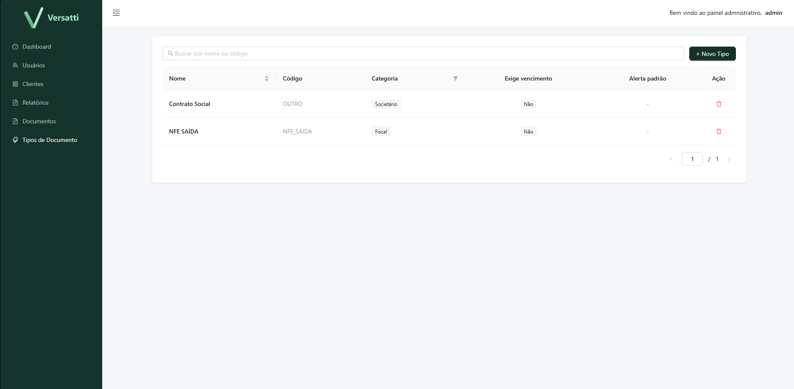
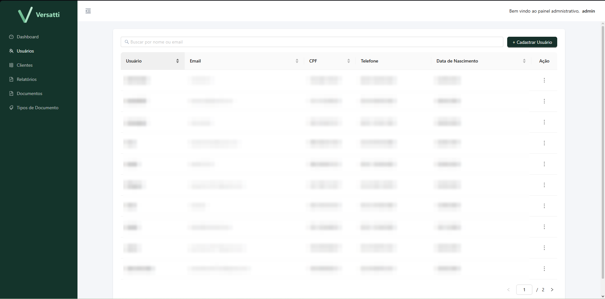
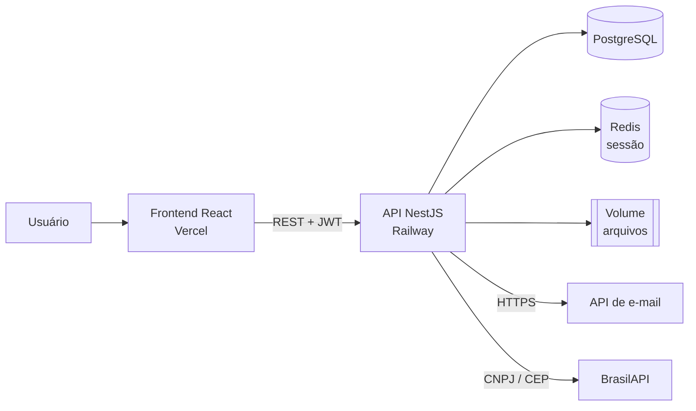

# Versatti Contábil

Sistema web de **gestão documental para escritório de contabilidade**: centraliza os documentos fiscais, societários e trabalhistas das empresas atendidas, controla vencimentos e entrega os arquivos ao cliente por e-mail.

Desenvolvido sob demanda para o escritório **Versatti Contabilidade** e em produção.


---

## O problema

O escritório atende dezenas de empresas e cada uma tem documentos com prazo de validade — alvarás, certidões negativas (CND), certificados digitais — além de um volume grande de notas fiscais em XML. Antes, isso vivia em pastas e planilhas: vencimentos passavam despercebidos e enviar documentos aos clientes era manual.

## A solução

| Para o escritório (admin) | Para a empresa cliente |
|---|---|
| Cadastro de empresas com preenchimento automático pelo CNPJ (BrasilAPI) | Acesso apenas às próprias empresas e aos documentos liberados para ela |
| Envio de documentos em lote (até 50 arquivos por vez) | Envio de documentos para o escritório |
| Envio automático por e-mail ao responsável da empresa, com anexos | Download dos documentos e das notas |
| Tipos de documento configuráveis, com regra de vencimento e alerta | |
| Dashboard de vencimentos e relatórios exportáveis | |

### Funcionalidades

- **Documentos por empresa** — upload múltiplo, categorias (fiscal, certidões, licenças, societário…), situação calculada automaticamente: *em dia*, *vence em breve*, *vencido*.
- **Notas fiscais** — upload de XML de NF-e/NFC-e; no download, o usuário escolhe entre o **XML** original ou o **PDF (DANFE) gerado na hora** a partir do XML.
- **Dashboard** (Recharts) — vencimentos dos próximos 6 meses, situação dos documentos, envios por mês, volume por categoria e ranking de empresas com pendências. Cada indicador leva à lista já filtrada.
- **Relatórios** — vencimentos por período, checklist documental por empresa (inclusive documentos *faltando*) e histórico de envios por usuário. Exportação para **Excel** e **PDF**.
- **Controle de acesso** — perfis administrador e cliente, com o escopo de dados aplicado no backend em todas as consultas.
- **Auditoria** — registros guardam quem criou, alterou e excluiu (`createdBy`, `updatedBy`, `deletedBy`), com exclusão lógica (soft delete).

---

## Telas

> Dados pessoais, CNPJs e nomes de documentos foram ocultados nas imagens.

### Dashboard
Indicadores de vencimento, situação dos documentos, envios por mês e volume por categoria.



### Documentos
Listagem por empresa com categoria, situação, visibilidade para o cliente e ações de visualizar e baixar.



### Relatórios
Vencimentos por período, situação por empresa e documentos enviados, com exportação para Excel e PDF.



### Empresas
Cadastro das empresas atendidas, com dados preenchidos automaticamente a partir do CNPJ.



### Tipos de documento
Tipos configuráveis pelo escritório, com categoria, regra de vencimento e alerta padrão.



### Usuários
Gestão de acessos do escritório e das empresas clientes.



---

## Arquitetura



### Stack

| Camada | Tecnologias |
|---|---|
| **Backend** | NestJS 11, TypeORM (migrations), PostgreSQL, Redis (ioredis), Passport JWT, class-validator, Multer, Nodemailer |
| **Frontend** | React 19, Vite, TypeScript, Ant Design, styled-components, React Router, Recharts, ExcelJS, jsPDF |
| **Infra** | Railway (API, Postgres, Redis, volume persistente), Vercel (front), Docker Compose (ambiente local) |

---

## Decisões técnicas

Alguns problemas reais que apareceram no caminho e como foram resolvidos:

- **Escopo de dados no banco, não na tela.** Usuário cliente só enxerga empresas vinculadas a ele e documentos marcados como visíveis. A regra está nas queries do backend (listagem, download, dashboard e relatórios), então não é possível contorná-la chamando a API diretamente.
- **DANFE sob demanda.** O PDF da nota não é armazenado: é gerado a partir do XML no momento do download. Isso evita arquivos duplicados e garante que o PDF sempre corresponda ao XML. XMLs que não são de NF-e/NFC-e autorizada retornam um erro claro (422) em vez de falhar.
- **Sessão com expiração por inatividade.** Além do JWT, o último acesso de cada usuário fica no Redis; após 15 minutos sem atividade, a sessão é encerrada.
- **Deploy seguro de migrations.** As migrations rodam em uma etapa de *pre-deploy*; se falharem, a versão anterior continua no ar. O tráfego só é liberado quando o *health check* (`/health`) responde.
- **Arquivos fora do container.** Os documentos ficam em um volume persistente configurável (`STORAGE_PATH`), já que o disco do container é apagado a cada deploy.
- **Dependência externa sem ponto único de falha.** A consulta de CNPJ à BrasilAPI no servidor apenas complementa os dados do formulário: se a API estiver indisponível, o cadastro continua.
- **E-mail por API HTTPS.** A hospedagem bloqueia SMTP de saída; o serviço de e-mail suporta SMTP (desenvolvimento, com caixa de teste) e API HTTPS (produção), escolhidos por variável de ambiente.
- **Envio agrupado.** Um lote de 30 notas gera **um** e-mail por empresa com todos os anexos (respeitando o limite de tamanho), não 30 e-mails.
- **Bundle enxuto.** As bibliotecas de exportação (ExcelJS, jsPDF) são carregadas sob demanda, só quando o usuário exporta um relatório.
- **Gráficos acessíveis.** Paleta validada para daltonismo e contraste; situação nunca é indicada só por cor — sempre com ícone e rótulo.

---

## Estrutura

```
backend/
  src/
    entities/          entidades TypeORM (base com auditoria e soft delete)
    migrations/        histórico do schema
    modules/
      auth/            login, primeiro acesso por CPF, JWT, guards
      client/          empresas e vínculo usuário ↔ empresa
      documents/       upload, download, DANFE, tipos, envio por e-mail
      dashboard/       indicadores agregados
      reports/         relatórios
      mail/            envio de e-mail (SMTP ou API)
      storage/         armazenamento de arquivos
frontend/
  src/
    pages/             telas
    hooks/             regras de tela e chamadas à API
    service/           integração HTTP por domínio
    components/        componentes reutilizáveis
```

---

## Rodando localmente

**Pré-requisitos:** Node.js 22+, Yarn, Docker.

```bash
# 1. Banco e Redis
cd backend
cp .env.example .env        # preencha as variáveis
docker compose up -d

# 2. API
yarn
yarn migration:run
yarn start:dev              # http://localhost:3000

# 3. Frontend (outro terminal)
cd frontend
cp .env.example .env        # VITE_API_LOCAL=http://localhost:3000
yarn
yarn dev                    # http://localhost:5173
```

No VS Code, as tarefas em `.vscode/tasks.json` sobem tudo com um comando (**Tasks: Run Task → LOCAL: tudo**).

## Ambientes e deploy

| Ambiente | Branch | Onde |
|---|---|---|
| Local | `feature/*` | Docker Compose |
| Homologação | `develop` | Railway (staging) + Vercel preview |
| Produção | `main` | Railway (production) + Vercel |

Cada merge publica automaticamente no ambiente correspondente. O passo a passo de infraestrutura está em [DEPLOY.md](DEPLOY.md).

---

## Padrões do projeto

- Código em inglês; interface em português.
- Arquivos e pastas em minúsculo, separados por `-` (ex.: `client-user.entity.ts`).
- Alterações de banco sempre por migration, versionada junto com o código.

**Paleta:** `#16302A` `#1E3B32` `#AD8A4E` `#C9A968`

---

## Autor

**João Vitor Heleno Marinho** — desenvolvimento full stack (backend, frontend e infraestrutura).

[GitHub](https://github.com/joaovitorheleno)
